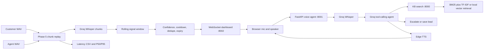

# System Architecture

## Runtime boundaries

- `kb.api:app` owns approved retrieval and citations.
- `voice_agent.agent:app` owns the single-turn and localized `/turn` workflow.
- `live_nudges.dashboard:app` owns dashboard delivery and `/publish` producer input.
- `live_nudges.run_real_stream` replays separate customer and agent WAV channels.
- `.env` contains local secrets and is ignored; `.env.example` is safe to share.
